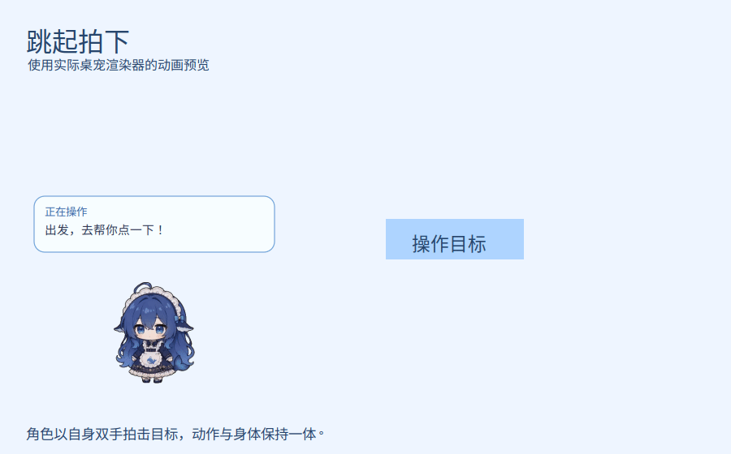
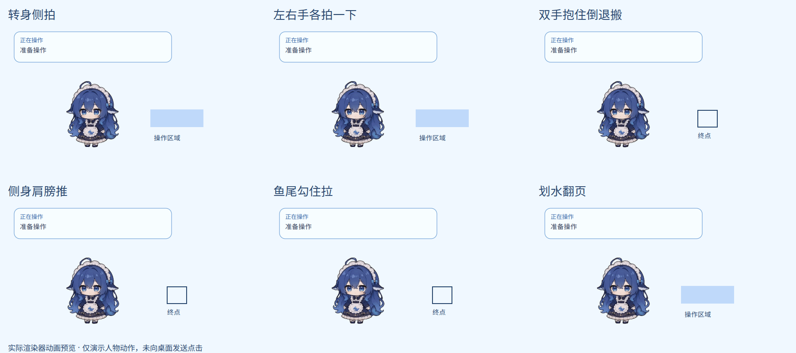
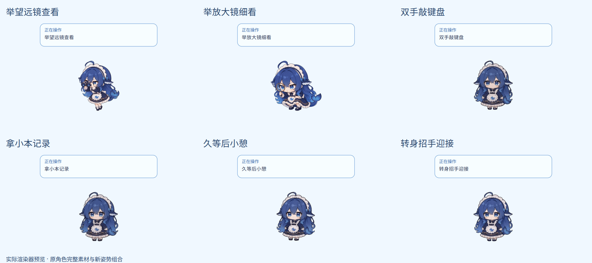

# DSH Computer Use Fish 🐋

让 AI 的电脑操作变成看得见的角色动作。

鲸鱼娘奔跑到操作目标，跳起拍击、交替双拍、搬运拖拽、划水翻页，也会举起望远镜观察、记录输入，在等待时抱碗休息。电脑控制与桌宠动画由同一个 DeepSeek Harness 插件协调完成。

## 动作预览

### 跳起来，拍一下



### 同一种操作，也有不同表演



### 观察、输入与等待都有回应



以上为项目渲染逻辑生成的隔离场景动画预览，并非真实桌面操作录像。实际输入由 cua-driver 执行，桌宠负责呈现操作过程；动画效果不代表操作已成功，最终结果以驱动反馈与回读为准。

## 能力与边界

- **12 个电脑操作工具**：屏幕观测与缩放、点击、双击、右键、输入、按键、滚动、拖拽、等待、应用枚举与启动。
- **每类操作有三个动作候选**：同一个工具会按场景选择奔跑、跳拍、转身拍、交替双拍、搬运、推拉、划水、观察、输入或等待等表演；一次真实点击不会因动画变体增加次数。
- **手臂与角色一体**：动作由角色自身的手臂完成，不使用外接手套或延长线。
- **先准备动画，再执行输入**：动画进入可执行姿势后才交由 cua-driver 执行真实输入；桌宠只接收操作类别、状态与几何位置，不接收输入内容或截图，也不执行输入。
- **桌宠可以关闭**：关闭桌宠后电脑控制仍然可用，动画不是电脑控制的前置条件。
- **不是 36 段独立绘制动画**：12 类操作各有三个候选，但当前由完整角色姿势与已有动画组合而成，不是 36 段逐段独立绘制的动画。

## 工作方式

Harness → 插件编排 → cua-driver 执行截图与鼠标键盘操作。

插件通过本地私有 socket 启动 Python/GTK 桌宠，依次呈现靠近、准备、执行和结果动作。动画程序只接收操作类别、状态与位置，不接收输入内容或截图，不执行真实输入。动画准备完成后，输入才交给驱动执行。

## 兼容性与验证

当前主要在 Ubuntu/GNOME Wayland + XWayland、单屏 200% 缩放环境验证，配合 Node 22.23.3、Harness 0.2.1-rc.2、cua-driver 0.37.0。其他桌面环境与多屏布局仍需验证；Linux 前台输入重试、坐标换算与快照保护已有测试覆盖。

## 本地开发

需要 Node >=22.18、npm 和 Python 3。纯逻辑测试不需要图形会话：

```sh
npm ci
npm test
npm run check
python3 -m unittest discover -s companion -p 'test_*.py'
```

实际桌宠另外需要当前图形会话的 GTK3、PyGObject、Cairo 和 XWayland；真实电脑控制还需要独立安装并运行 cua-driver。浏览器/桌面实测会产生真实输入，应使用仓库中的隔离测试窗口。

## 安装与配置

仓库地址：<https://github.com/TZ-WYmail/dsh-computer-use-fish>。仓库名称为 `dsh-computer-use-fish`，为兼容现有配置，包名和 bundle 标识仍是 `dsh-computer-use`。不要在同一 profile 同时加载原版和此版本，否则工具名称会冲突。

已有本机安装仍从 `~/.local/share/dsh/plugins/dsh-computer-use-fish` 加载，不因源代码迁移而改变。更换部署来源后需显式部署代码；修改本仓库不会自动替换运行版本。

插件配置：`companionEnabled`、`companionSize`（200–420）、`companionReducedMotion`。已配置本机显示命令时，`dsh-fish show/hide/status` 只控制显示；隐藏不会取消任务。

原版 `install.sh` 面向 harness-desktop 的 home patch 布局，不是当前 Linux profile 的通用迁移器。新设备应先确认 Harness profile 和依赖布局、备份配置，再配置本地包路径与 bundle；不要直接照搬本机绝对路径。

## 维护与来源

- [独立仓库维护说明](docs/MAINTENANCE.md)
- [第三方来源与许可](THIRD_PARTY.md)
- [动画实现与版本记录](companion/README.md)
- [设计方案](docs/fat-fish-companion-plan.md)
- [上游原始说明存档](docs/UPSTREAM-README.md)（仅作历史参考，里面的下载、商店与发布信息属于上游）

本仓库保留上游 Git 历史，`upstream` 仅作为原作者仓库的来源参考，不用于推送；本项目不是 DeepSeek 官方产品，也未发布 npm 包。

## 许可

程序代码使用 MIT 许可。角色素材（鲸鱼娘形象、姿势与动画）有单独的非商业与相同方式共享要求，不能按 MIT 代码许可处理；署名、来源链接与许可说明见 [THIRD_PARTY.md](THIRD_PARTY.md)。
